# @lessconversation/static-site-hls

Serve a [Scroll](https://scroll.pub) site's videos over HLS.

Plain `.mp4` files on a static site load poorly on phones: the browser has to fetch a large file before playback settles, and a background video stays blank for seconds on a slow connection. HLS splits a video into short segments behind a playlist, which every modern browser can stream.

## Contents

- [Installation](#installation)
- [How it works](#how-it-works)
- [Usage by example](#usage-by-example)
- [Detailed usage](#detailed-usage)
- [Special topics](#special-topics): [playback](#playback), [data folder](#data-folder-structure), [Scroll file rewriting](#scroll-file-rewriting), [posters](#posters), [local testing](#local-testing), [local builds](#local-builds), [index versions](#index-versions), [programmatic use](#programmatic-use)
- [Developer documentation](docs/README.md)

## Installation

Requirements:

- **Node.js 24** or newer.
- **Scroll**, to rebuild the site: `npm install -g breck7/scroll`, or a `scroll` in the site's `node_modules/.bin`, which is preferred when present.
- **H.264 videos.** Video is copied into HLS, not re-encoded (see [why](#playback)). Other codecs are reported and left as they are.

```sh
npm install -g @lessconversation/static-site-hls
static-site-hls --help
```

Or run it without installing: `npx @lessconversation/static-site-hls --help`.

## How it works

`static-site-hls` does the following:

1. finds every local video the site's `.scroll` files use;
2. converts each one to HLS with the [WASIX](https://wasix.org) build of ffmpeg, so no native ffmpeg is needed, and makes a poster from its first frame;
3. points the `.scroll` files at the playlists, adds a small player for browsers without native HLS, and rebuilds the HTML with `scroll build`;
4. remembers what it did in an index, so later runs only convert videos whose content changed.

```mermaid
---
config:
  flowchart:
    curve: step
    nodeSpacing: 28
    rankSpacing: 40
    subGraphTitleMargin:
      top: 6
      bottom: 14
---
flowchart TB
  subgraph key ["diagram key"]
    direction LR
    keyProgram(["program"]):::program
    keyFiles[("files")]:::files
    keyStep{{"process/step"}}:::step
    keyProgram ~~~ keyFiles ~~~ keyStep
  end
  key ~~~ start

  subgraph start ["1. Start"]
    direction TB
    invoke{{"invoke static-site-hls<br/>on a Scroll site"}}:::step
    tool(["static-site-hls"]):::program
    site[("Scroll static site<br/>.scroll files + videos")]:::files
    index1[("static-site-hls index<br/>which page uses<br/>which video,<br/>what changed")]:::files
    invoke --> tool
    invoke --> site
    tool -->|scan| index1
    site -->|"read, hashed"| index1
  end

  subgraph conversion ["2. Conversion"]
    direction TB
    convert{{"convert new or<br/>changed videos"}}:::step
    ffmpeg(["WASIX ffmpeg<br/>converter"]):::program
    hls[("generated<br/>HLS videos<br/>playlists, segments,<br/>posters")]:::files
    index2[("static-site-hls<br/>index, updated")]:::files
    scrolls[("updated<br/>.scroll files<br/>pointing at<br/>the playlists")]:::files
    convert --> ffmpeg
    ffmpeg --> hls
    convert --> index2
    convert --> scrolls
  end

  subgraph rebuild ["3. Rebuild"]
    direction TB
    build{{"rebuild the site"}}:::step
    scroll(["Scroll<br/>scroll build"]):::program
    built[("rebuilt site<br/>HTML, player inlined,<br/>videos → playlists")]:::files
    build --> scroll
    scroll --> built
  end

  subgraph result ["4. End result"]
    direction TB
    deploy{{"commit and deploy"}}:::step
    live[("a Scroll site that<br/>streams its videos<br/>over HLS, with posters")]:::files
    deploy --> live
  end

  start -->|"index: what to convert"| conversion
  conversion -->|"HLS videos, index,<br/>updated .scroll files"| rebuild
  rebuild -->|"rebuilt site"| result

  classDef program fill:#dbeafe,stroke:#1d4ed8,stroke-width:2px,color:#0f172a
  classDef files fill:#fef3c7,stroke:#b45309,stroke-width:2px,color:#0f172a
  classDef step fill:#dcfce7,stroke:#15803d,stroke-width:2px,color:#0f172a
  style key fill:#ffffff,stroke:#94a3b8,stroke-width:1px,stroke-dasharray:4 4,color:#0f172a
  style start fill:#f8fafc,stroke:#64748b,stroke-width:1px,color:#0f172a
  style conversion fill:#f8fafc,stroke:#64748b,stroke-width:1px,color:#0f172a
  style rebuild fill:#f8fafc,stroke:#64748b,stroke-width:1px,color:#0f172a
  style result fill:#f8fafc,stroke:#64748b,stroke-width:1px,color:#0f172a
  linkStyle default stroke:#64748b,stroke-width:2px
  %% links 0-2 are the invisible spacers that lay out the key; keep them first
  linkStyle 0,1,2 stroke:none,stroke-width:0
```

<details>
<summary>Diagram: how static-site-hls works, stage by stage</summary>



</details>

`static-site-hls scan` runs only stage 1 and writes nothing; `static-site-hls convert` (the default command) runs stages 1 to 3. Stage 4 is yours: everything the tool generates lives in one folder of the site, `static-site-hls/`, which you commit and deploy with the site.

## Usage by example

One small site, growing over five steps. All output below is from real runs, shortened where marked.

### 1. A page with a video

```
my-site/
  index.scroll
  media/intro.mp4
```

```
title My Site
buildHtml

# Welcome

video media/intro.mp4
 loop
```

Look first. `scan` shows what would happen and changes nothing:

```console
$ static-site-hls scan my-site

Site:   /tmp/my-site
Data:   static-site-hls/   videos served from static-site-hls/videos/   posters on
Index:  static-site-hls/index.json (new)

index.scroll
  media/intro.mp4 → static-site-hls/videos/media/intro/index.m3u8  [convert (new)]

1 video(s) on 1 page(s); 1 to convert
```

Then convert. Without `--yes` it shows the same plan and asks `Convert videos and update sources? (Y/n)`:

```console
$ static-site-hls my-site --yes
…
loading WASIX ffmpeg (package cache: ~/.cache/static-site-hls)
media/intro.mp4: converting (new)
media/intro.mp4: 1 segment + poster → static-site-hls/videos/media/intro/index.m3u8
index.scroll: updated
scroll build in site root/
💾 Built index.html from index.scroll

Done: 1 converted, 0 not convertible, 0 failed, 0 removed, 1 source(s) updated.
```

What changed:

```diff
 # Welcome

-video media/intro.mp4
+inlineJs static-site-hls/static-site-hls.js
+video static-site-hls/videos/media/intro/index.m3u8
  loop
```

```
my-site/
  index.scroll                      rewritten (above)
  index.html                        rebuilt: <video src="static-site-hls/videos/media/intro/index.m3u8" controls loop>
  media/intro.mp4                   unchanged: still the source
  static-site-hls/
    index.json                      what was converted, and from which bytes
    static-site-hls.js              player, inlined into the page by Scroll
    hls.min.js                      hls.js, for browsers without native HLS
    videos/media/intro/
      index.m3u8  000.ts  poster.jpg
```

Commit all of it and deploy as usual.

### 2. Replacing a video

Overwrite the file in place, same name, and run again:

```console
$ cp ~/Downloads/new-intro.mp4 my-site/media/intro.mp4
$ static-site-hls my-site --yes
…
index.scroll
  media/intro.mp4 → static-site-hls/videos/media/intro/index.m3u8  [convert (source changed)]
…
media/intro.mp4: converting (changed)
Done: 1 converted, 0 not convertible, 0 failed, 0 removed, 0 source(s) updated.
```

Only `media/intro.mp4`, its HLS folder and `index.json` changed. The page already points at the playlist, so no `.scroll` file is touched and nothing is rebuilt. Changes are detected by content hash, so re-running with nothing changed does nothing.

### 3. More pages, more kinds of reference

Add `talks/index.scroll`. It uses a bare video line, an HTML `<source>` with a VP9 file, and the intro video again:

```
title Talks
buildHtml

# Keynote

../media/keynote.mp4

# Demo

<video controls muted><source src="/media/demo.webm" type="video/webm"></video>

# Intro again

video ../media/intro.mp4
```

```console
$ static-site-hls my-site --yes
…
talks/index.scroll
  media/keynote.mp4 → static-site-hls/videos/media/keynote/index.m3u8  [convert (new)]
  media/demo.webm → static-site-hls/videos/media/demo/index.m3u8  [convert (new)]
  media/intro.mp4 → static-site-hls/videos/media/intro/index.m3u8  [up to date]
…
media/keynote.mp4: 2 segments + poster → static-site-hls/videos/media/keynote/index.m3u8
media/demo.webm: skipped: video codec is vp9; only H.264 can be converted (stream copy), …
talks/index.scroll: updated
scroll build in site root/
scroll build in talks/
Done: 1 converted, 1 not convertible, 0 failed, 0 removed, 1 source(s) updated.
```

```
# Keynote

inlineJs ../static-site-hls/static-site-hls.js
video ../static-site-hls/videos/media/keynote/index.m3u8

# Demo

<video controls muted><source src="/media/demo.webm" type="video/webm"></video>

# Intro again

video ../static-site-hls/videos/media/intro/index.m3u8
```

- The intro video is shared, so it was not converted again.
- The VP9 clip keeps playing from the original file. Re-encode it to H.264 and run again to convert it.
- Relative references stay relative, and the bare line became a `video` line, because Scroll's bare form only accepts video file extensions.

### 4. Choosing where videos live

Serve the HLS files from `static-site-hls/media-hls/` and drop the posters:

```console
$ static-site-hls my-site --yes --videos-dir media-hls --no-posters
Data:   static-site-hls/   videos served from static-site-hls/media-hls/   posters off
Move:   static-site-hls/videos/ → static-site-hls/media-hls/
…
moved static-site-hls/videos/ → static-site-hls/media-hls/
media/intro.mp4: removed its poster
media/keynote.mp4: removed its poster
index.scroll: updated
talks/index.scroll: updated
Done: 0 converted, 0 not convertible, 0 failed, 0 removed, 2 source(s) updated.
```

Nothing is converted again. Both settings are saved in the index, so later runs keep them without the flags. In CI, `--yes` skips the prompt, and `--no-build` leaves building to your own pipeline.

### 5. Testing before you deploy

```console
$ static-site-hls serve my-site
Serving /tmp/my-site at http://localhost:8080/  (Ctrl+C to stop)
```

The server sends the right HLS content types and revalidates every request, so a re-converted video shows up on reload. Open the page and check the videos play, then compare Lighthouse against your live site; see [local testing](#local-testing).

### 6. Upgrading static-site-hls

Newer versions may change the index format. Nothing to do by hand: `scan` reports it and `convert` upgrades the file.

```console
$ static-site-hls scan my-site
Index:  static-site-hls/index.json (version 1; convert upgrades it to version 2)
$ static-site-hls my-site --yes
upgraded static-site-hls/index.json from version 1 to 2
Done: 0 converted, …
```

An index written by a newer static-site-hls than the one you run is refused, with a message to upgrade, rather than misread.

## Detailed usage

```
static-site-hls [convert] [site-root] [options]
static-site-hls scan [site-root] [options]
static-site-hls serve [site-root] [--port <n>]
```

| Command | What it does |
| --- | --- |
| `convert` | Default. Scan the `.scroll` files, convert new or changed videos, rewrite the sources, update the index, run `scroll build`. |
| `scan` | Print the page → video map, each video's status and the index state. Writes nothing. |
| `serve` | Serve the site at `http://localhost:<port>/` for testing. |

`site-root` is the Scroll site's root folder. Left out in a terminal, the tool asks for it (default: the current folder); outside a terminal it is required.

| Option | Default | Meaning |
| --- | --- | --- |
| `--data-dir <dir>` | `static-site-hls` | Folder inside the site for everything the tool generates. |
| `--videos-dir <dir>` | saved value, else `videos` | Folder, relative to `--data-dir`, that the HLS videos are served from. A new value moves the existing videos and rewrites the sources. Saved in the index. |
| `--posters` / `--no-posters` | saved value, else on | Make a `poster.jpg` from each video's first frame. Turning them off deletes existing posters; turning them back on makes them for every video. Saved in the index. |
| `--no-build` | build | Don't run `scroll build` after rewriting sources. |
| `-y`, `--yes` | ask | Don't ask for confirmation. Also implied outside a terminal. |
| `-p`, `--port <n>` | `8080` | Port for `serve`. |
| `-h`, `--help` | | Show help. |
| `-v`, `--version` | | Show the version. |

Video statuses in `scan` and `convert` output:

| Status | Meaning | Converted? |
| --- | --- | --- |
| `convert (new)` | Never converted | yes |
| `convert (source changed)` | Its bytes changed since the last conversion | yes |
| `convert (HLS output or poster missing)` | Output folder or poster was deleted | yes |
| `up to date` | Nothing to do | no |
| `not convertible: <reason>` | Not H.264; pages keep the original file | no, until the file changes |
| `source file missing; keeping existing HLS` | The source was deleted but pages still use its playlist | no |

When no page references a video any more, its HLS folder is deleted on the next `convert`.

Exit status: `0` on success; `1` on an error, or when any video failed to convert. The other videos are still converted.

## Special topics

### Playback

Video is stream-copied into HLS, not re-encoded. That is lossless and fast, and it is the only option: the WASIX ffmpeg build has no H.264 encoder. So sources must be H.264, and segments can only split at the source's keyframes. Audio is copied when it is AAC or MP3 and re-encoded to AAC otherwise.

In the browser, the inlined player:

- sets posters (see [Posters](#posters));
- does nothing else where HLS is native (Safari, iOS, recent Chrome);
- elsewhere, loads `hls.min.js` from the data folder the first time a playlist is needed, and attaches it to `<video src="….m3u8">`, `<video><source src="….m3u8">`, videos added later, and scripts that assign `video.src = "….m3u8"`. Script assignments are taken over before the browser tries the playlist itself.

### Data folder structure

```
static-site-hls/                --data-dir
  index.json                    settings, every video's state and content hash, page → video map
  static-site-hls.js            player script, inlined into each page that plays HLS
  hls.min.js                    hls.js, copied on every convert
  videos/                       --videos-dir
    <path without extension>/   one folder per video, e.g. media/intro/
      index.m3u8                playlist
      000.ts 001.ts …           segments
      poster.jpg                first frame, unless --no-posters
```

Everything here is generated: commit it, deploy it, never edit it. Keep your original videos where they are; they are the sources, and the fallback for videos that can't be converted.

### Scroll file rewriting

| In a `.scroll` file | After conversion |
| --- | --- |
| `video clip.mp4` | `video static-site-hls/videos/clip/index.m3u8` |
| `clip.mp4` alone on a line | `video static-site-hls/videos/clip/index.m3u8` |
| `<video src="clip.mp4">`, `<source src="clip.mp4" type="video/mp4">` | `src` points at the playlist; a `<source>` `type` becomes `application/vnd.apple.mpegurl` |
| `"clip.mp4"` in a `script` block | `"static-site-hls/videos/clip/index.m3u8"` |

Plus one `inlineJs …/static-site-hls.js` line per page that plays HLS, before the first particle using a converted video.

- Only references to existing local video files are touched. They resolve relative to the `.scroll` file's folder, or to the site root when they start with `/`. External URLs are ignored.
- Raw-text blocks (`code`, `css`, comments, `quote`, parser definitions, …) are never scanned, so example code stays as it is.
- Relative stays relative, root-absolute stays root-absolute.
- A script string equal to a video path is rewritten even if it isn't used for playback (a download link, say).
- A page with a `permalink` into another folder, or a file imported from another folder, may resolve differently.

Details: [docs/scroll-integration.md](docs/scroll-integration.md).

### Posters

An HLS video can't show anything until its whole first segment has arrived. With keyframes 8 seconds apart that segment is several hundred KB, so on a phone the video area stays empty for seconds; on launchation.com Lighthouse's throttled Speed Index went from 6.6 s (mp4) to 10.6 s (HLS without posters). With posters it was about 4 s.

So each video gets `poster.jpg`, its first frame, and the player sets it as the `poster` of any video playing a static-site-hls playlist, including when a script switches `video.src` to another playlist. A poster the page sets itself is never replaced. (Scroll's `video` lines can't carry a `poster` attribute, which is why the player sets it.)

To shrink the first segment itself, re-export the source with keyframes every ~2 seconds and run the tool again. That needs an H.264 encoder outside this tool.

### Programmatic use

```js
import { scan, apply } from "@lessconversation/static-site-hls"

const plan = await scan("./site", { videosDir: "videos", posters: true })
const result = await apply(plan, { build: true, log: console.log })
```

Also exported:

- `@lessconversation/static-site-hls/serve`: `serve(root, { port })`.
- `@lessconversation/static-site-hls/convert`: `openConverter(wasmer)`, which takes a `Wasmer` client from `@wasmer/sdk/node` or `@wasmer/sdk/browser`. In a browser, the page must be cross-origin isolated.
- `@lessconversation/static-site-hls/schemas/*`: the JSON Schemas.

Types and data flow: [docs/data-model.md](docs/data-model.md).

### Local testing

`static-site-hls serve <site>` serves `.m3u8` as `application/vnd.apple.mpegurl`, `.ts` as `video/mp2t`, and every file with `cache-control: no-cache`. That revalidates each request, so re-converted videos appear on reload, while keeping the back/forward cache working (`no-store` would disable it, and Lighthouse would report it).

For Lighthouse, run the same settings against the local and the live site, more than once each. The default `simulate` throttling loads at full speed and estimates; HLS start-up delays only show with real throttling:

```sh
npx lighthouse http://localhost:8080/ --view --throttling-method=devtools
```

### Local builds

To run an unpublished checkout of this tool on a site, from this repository:

```sh
npm install
npm run try -- scan ../my-site
npm run try -- ../my-site --videos-dir streams
npm run try -- serve ../my-site
```

`npm run try` packs the package as it would be published and runs the packed CLI, so files missing from the package show up here.

### Index versions

`index.json` has a format version, and every version has a JSON Schema in [`schemas/`](schemas/). Each read validates the file against its version's schema and migrates it to the current version; each write validates the result. Older indexes are upgraded on the next `convert`, and newer ones are refused. Details: [docs/data-model.md](docs/data-model.md#index-versions-and-migrations).


## Developer documentation

Architecture (C4 diagrams), Scroll integration, timing diagrams, data model, tests, dependency updates and staged releases: [docs/README.md](docs/README.md).
