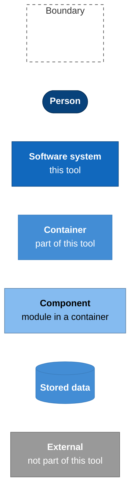
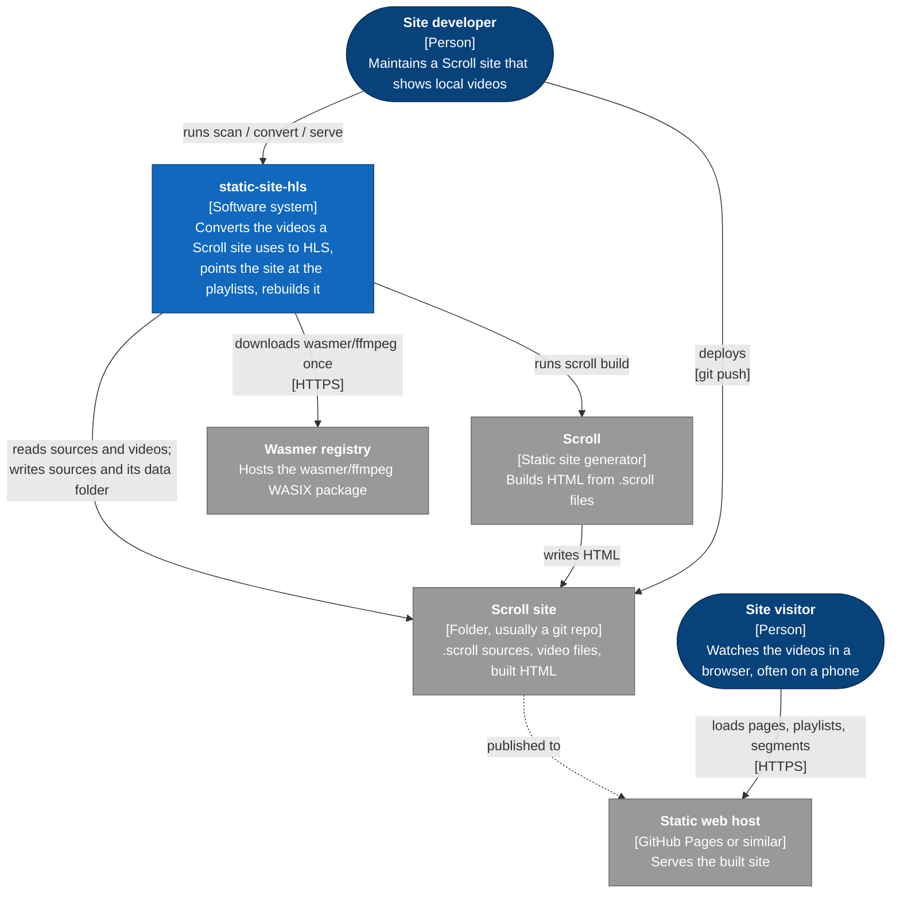
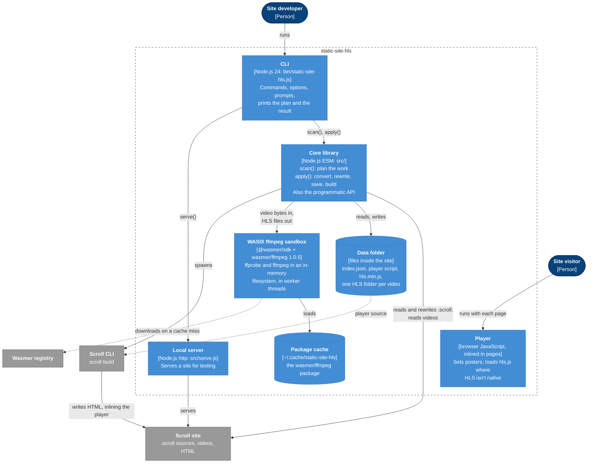
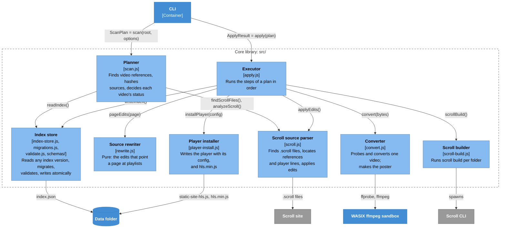
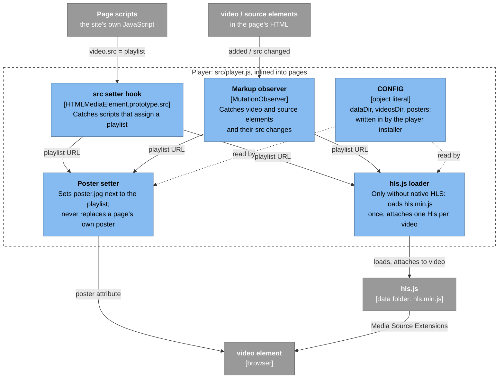
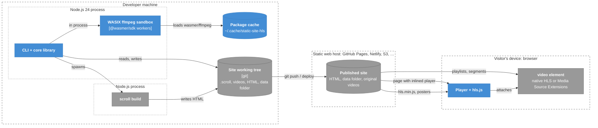

# Architecture

static-site-hls described with the [C4 model](https://c4model.com), from the widest view inward:

1. [System context](#level-1-system-context): who and what the tool deals with.
2. [Containers](#level-2-containers): the separately running or separately stored parts.
3. [Components](#level-3-components): the modules inside the core library and inside the browser player.
4. [Deployment](#deployment): where each part runs.

Then a [module map](#module-map) and the [design decisions](#design-decisions) behind the shape. How the parts talk over time is in [workflows.md](workflows.md); the data they pass is in [data-model.md](data-model.md).

**Notation.** C4 elements drawn as flowcharts (mermaid's own C4 diagrams lay out poorly):

## Level 1: System context

static-site-hls never talks to the web host or the visitor. Everything that reaches the visitor goes through the Scroll site: the rewritten pages, the HLS files and the player, all deployed like any other file of the site.

## Level 2: Containers

| Container | Runs where | Lifetime |
| --- | --- | --- |
| CLI, core library | Developer's machine, one Node.js process | One command |
| WASIX ffmpeg sandbox | Same process, @wasmer/sdk worker threads | One `convert`, only when something needs converting |
| Local server | Developer's machine | Until Ctrl+C |
| Data folder | Inside the site; committed and deployed with it | Permanent; [versioned](data-model.md#index-versions-and-migrations) |
| Package cache | Developer's machine | Permanent; safe to delete |
| Player | Visitor's browser, inlined into every page that plays HLS | One page view |

## Level 3: Components

### Core library

`layout.js` (not drawn) holds the names every component shares: the default folders, `index.json`, `static-site-hls.js`, `hls.min.js`, `index.m3u8`, `poster.jpg`.

### Player

With native HLS (Safari, iOS, recent Chrome), the loader stays idle: the browser plays the playlist URL itself and only posters are set.

## Deployment

The original video files stay in the site and are deployed with it: they are the conversion sources, and pages fall back to them for videos that can't be converted.

## Module map

| Module | C4 component | Responsibility | Uses |
| --- | --- | --- | --- |
| `bin/static-site-hls.js` | CLI | Commands, options, prompts, output | `index.js`, `serve.js` |
| `src/index.js` | (public API) | Re-exports | the modules below |
| `src/scan.js` | Planner | `scan()` → `ScanPlan` | index store, parser, layout |
| `src/apply.js` | Executor | `apply()` → `ApplyResult` | every component |
| `src/scroll.js` | Scroll source parser | Find .scroll files, `analyzeScroll()`, `applyEdits()`, URL mapping | layout |
| `src/rewrite.js` | Source rewriter | `pageEdits()` (pure) | parser (`urlFor`) |
| `src/index-store.js` | Index store | `readIndex()`, `migrateIndex()`, `writeIndex()` | migrations, validate |
| `src/migrations.js` | Index store | Ordered index migrations | none |
| `src/validate.js` | Index store | Ajv validators for `schemas/*.json` | schemas |
| `src/convert.js` | Converter | `openConverter()`; runtime-agnostic (Node or browser) | a @wasmer/sdk client passed in |
| `src/player-install.js` | Player installer | `installPlayer()` | validate, layout |
| `src/scroll-build.js` | Scroll builder | `scrollBuild()` | layout |
| `src/serve.js` | Local server | `serve()` | none |
| `src/player.js` | Player | Browser script, installed into sites | none |
| `src/layout.js` | (shared) | File and folder names, `siteFolder()` | convert (output names) |

## Design decisions

- **Scroll sources, not HTML.** A Scroll site's HTML is generated, so edits to it would be overwritten by the next build. The tool rewrites the `.scroll` files and lets `scroll build` produce the HTML. See [scroll-integration.md](scroll-integration.md).
- **WASIX ffmpeg, stream copy.** The `wasmer/ffmpeg` WASIX build runs anywhere @wasmer/sdk runs (Node or a browser), with no native install. It has no H.264 encoder, so video is copied into HLS rather than re-encoded. That is lossless and fast, but sources must already be H.264, and segment lengths follow the sources' keyframes.
- **One persisted, versioned index.** Everything later runs need to know lives in `index.json`, validated against a JSON Schema on every read and write and migrated from older versions automatically. See [data-model.md](data-model.md).
- **Plan, then apply.** `scan()` only reads, so `static-site-hls scan` and the confirmation prompt show exactly what `convert` will do. `apply()` takes that plan; nothing is re-decided while files are being written.
- **Inlined player.** Scroll's `inlineJs` copies the player into each page: no extra request before the video, and it runs before the page's own scripts, so it can take over `video.src` assignments. The cost: pages must be rebuilt when the player changes, which `apply()` does.
- **Posters from the player.** Scroll's `video` lines can't carry a `poster` attribute, and pages often set `video.src` from script. Setting the poster where the playlist URL becomes known covers both.
