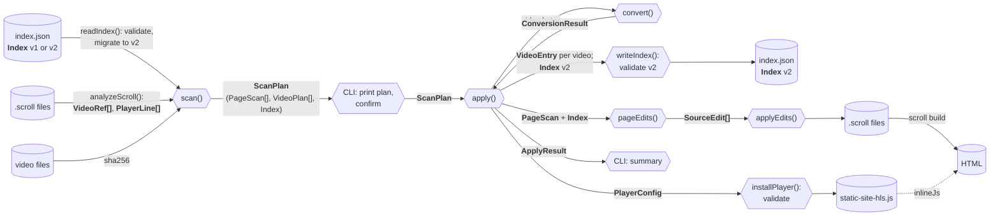
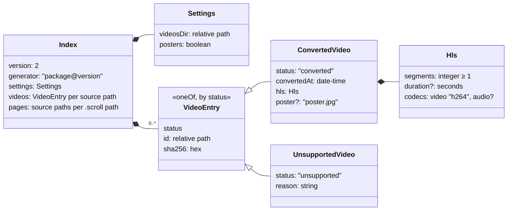
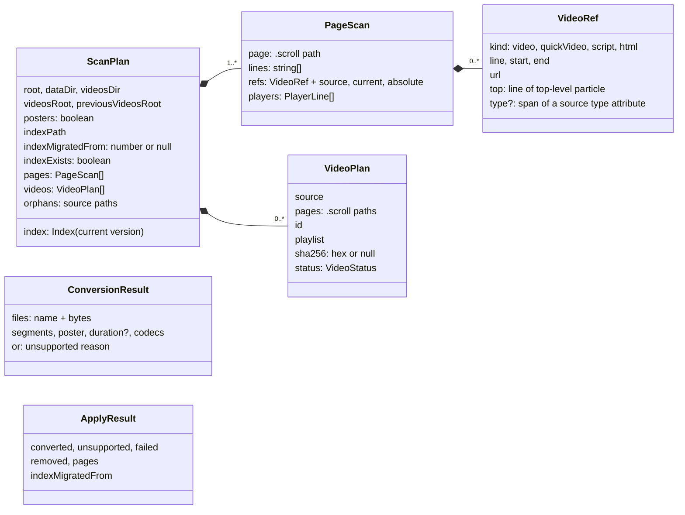

# Data model

The data static-site-hls passes between its components, and the files it keeps in a site.

- [How the types flow](#how-the-types-flow)
- [Persisted and embedded formats](#persisted-and-embedded-formats): JSON Schemas, validated at runtime
- [In-process types](#in-process-types): JSDoc typedefs
- [The data folder](#the-data-folder)
- [Index versions and migrations](#index-versions-and-migrations)

Two kinds of types:

| Kind | Where defined | Checked |
| --- | --- | --- |
| Data written into a site (index, player config) | JSON Schema, `schemas/*.schema.json`, shipped in the package | At runtime with Ajv, on every read and write (`src/validate.js`) |
| Data passed between functions in one run | JSDoc `@typedef` next to the function that produces it | By editors and reviewers only |

## How the types flow

<details>
<summary><h4>◆&ensp;Diagram&ensp;·&ensp;How the types flow between components&ensp;<sub>click to expand</sub></h4></summary>



</details>

## Persisted and embedded formats

### Index (`index.json`)

Schema: [`schemas/index.v2.schema.json`](../schemas/index.v2.schema.json) (current). Owner: the index store (`src/index-store.js`).

<details>
<summary><h4>◆&ensp;Diagram&ensp;·&ensp;The index (<code>index.json</code>) structure&ensp;<sub>click to expand</sub></h4></summary>



</details>

A real entry:

```json
{
  "version": 2,
  "generator": "@lessconversation/static-site-hls@0.1.0",
  "settings": { "videosDir": "streams", "posters": true },
  "videos": {
    "koa.mp4": {
      "status": "converted",
      "id": "koa",
      "sha256": "a39fb8cb75e190bd51c0d004bfaa12df197072ae8d1dfe1154214024126d83e3",
      "convertedAt": "2026-10-28T09:02:12.569Z",
      "hls": { "segments": 3, "duration": 27.894542, "codecs": { "video": "h264", "audio": "aac" } },
      "poster": "poster.jpg"
    }
  },
  "pages": { "readme.scroll": ["koa.mp4"] }
}
```

| Field | Meaning | Used for |
| --- | --- | --- |
| `settings` | `--videos-dir`, `--posters` from the last convert | defaults for the next run |
| `videos` keys | source path relative to the site root | mapping rewritten references back to sources |
| `id` | output folder relative to the videos folder; assigned once, then stable | playlist paths |
| `sha256` | content hash of the source | deciding `changed` |
| `pages` | which converted videos each page plays | documentation of the site's state; rebuilt every run |

### Player config

Schema: [`schemas/player-config.schema.json`](../schemas/player-config.schema.json). Owner: the player installer (`src/player-install.js`).

```json
{ "dataDir": "static-site-hls", "videosDir": "streams", "posters": true }
```

Written into the `/*CONFIG*/ {…}` literal of `<data-dir>/static-site-hls.js`, and from there inlined into every built page. It is validated before it is written but never migrated: the player file is regenerated from the index settings on every convert, and the pages are rebuilt when its bytes change.

## In-process types

| Type | Defined in | Produced by | Consumed by |
| --- | --- | --- | --- |
| `VideoRef` | `src/scroll.js` | `analyzeScroll()` | `scan()` |
| `PlayerLine` | `src/scroll.js` | `analyzeScroll()` | `pageEdits()` |
| `SourceEdit` | `src/scroll.js` | `pageEdits()` | `applyEdits()` |
| `ScanPlan`, `PageScan`, `VideoPlan`, `VideoStatus` | `src/scan.js` | `scan()` | CLI, `apply()` |
| `ConversionResult` | `src/convert.js` | `convert()` | `apply()` |
| `ApplyResult` | `src/apply.js` | `apply()` | CLI |
| `Index`, `VideoEntry` | `src/index-store.js` (mirrors the schema) | `readIndex()`, `apply()` | everything |
| `PlayerConfig` | `src/player-install.js` (mirrors the schema) | `apply()` | `installPlayer()` |

<details>
<summary><h4>◆&ensp;Diagram&ensp;·&ensp;In-process types&ensp;<sub>click to expand</sub></h4></summary>



</details>

`VideoStatus` is one of `new`, `changed`, `rebuild` (output or poster missing), `unchanged`, `unsupported`, `missing` (source deleted; output kept). `new`, `changed` and `rebuild` are converted.

## The data folder

```
<site>/static-site-hls/          --data-dir
  index.json                     Index (current version)
  static-site-hls.js             player, with PlayerConfig written in; inlined into pages
  hls.min.js                     hls.js, copied from this package's dependency on every convert
  videos/                        --videos-dir (saved in the index)
    <id>/                        one folder per converted video; id = source path without extension
      index.m3u8                 VOD playlist
      000.ts 001.ts …            MPEG-TS segments, split on the source's keyframes
      poster.jpg                 first frame, unless posters are off
```

Everything in it is generated, committed with the site and deployed with it. It can be deleted and regenerated from the sources, at the cost of converting every video again.

## Index versions and migrations

| Index version | Schema | Written by |
| --- | --- | --- |
| 1 | `schemas/index.v1.schema.json` (legacy, read only) | static-site-hls 0.1.x before index versioning; `posters` appears in later 0.1.x files only |
| 2 | `schemas/index.v2.schema.json` (current) | static-site-hls with `CURRENT_INDEX_VERSION = 2` |

Rules:

- **Read any older version, write only the current one.** `readIndex()` validates a file against the schema of its own version, then applies migrations one version at a time, validating after each step. The upgraded index exists in memory until `convert` saves it; `scan` never writes.
- **Refuse newer versions.** An index from a newer static-site-hls is rejected with an "upgrade static-site-hls" error instead of being misread or overwritten.
- **Never downgrade.** Older static-site-hls versions refuse newer files the same way.
- **Validate on write.** `writeIndex()` stamps `generator` and validates against the current schema before replacing the file atomically, so a bug can't leave an invalid index behind.
- **Keep migrations pure.** A migration takes the old object and returns a new one; no file access, no knowledge of the site. Anything that needs the site (for example, re-hashing files) belongs in `scan()`, driven by the migrated data.

### Changing the index format

1. Copy the current schema to `schemas/index.v<N>.schema.json`, set `"version": { "const": N }` and its `$id`, make the change.
2. Register it in `src/validate.js` (`INDEX_VALIDATORS`).
3. Append the `v<N-1> → v<N>` migration to `src/migrations.js`.
4. Set `CURRENT_INDEX_VERSION = N` in `src/index-store.js`; update `emptyIndex()`, the `Index` typedef, and the code in `scan.js` / `apply.js` / `rewrite.js` that reads or writes the changed fields.
5. Add real examples of version N-1 to `test/fixtures/index/` (copy them from a site; keep the old ones). `test/migrations.test.js` migrates every fixture to the current version.
6. Update this document's tables and diagrams.
7. Release with a minor (or major) version bump; the release notes should say that `convert` upgrades the index.

Run `npm test`. The migration tests need no network.
