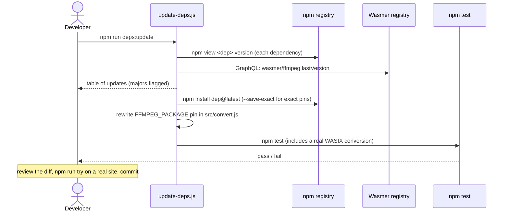
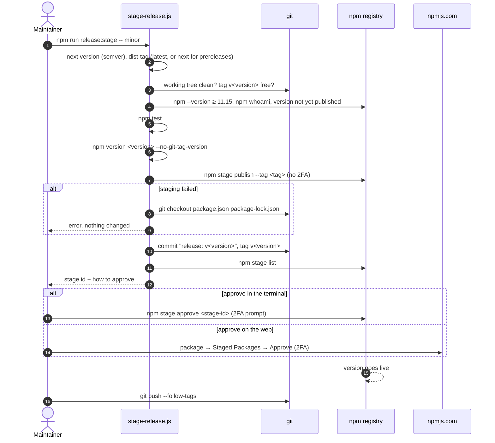

# Development

- [Setup](#setup)
- [Repository layout](#repository-layout)
- [Tests](#tests)
- [Trying changes on a real site](#trying-changes-on-a-real-site)
- [Updating dependencies](#updating-dependencies)
- [Releasing](#releasing)
- [Keeping things in sync](#keeping-things-in-sync)

## Setup

- Node.js 24 or newer (the Wasmer registry serves zstd-encoded packages that older Node `fetch` can't decode).
- npm 11.15 or newer to release (`npm stage`).
- Scroll, to build sites: `npm install -g https://github.com/breck7/scroll/archive/refs/heads/main.tar.gz` (the tarball avoids npm's git-dependency install, which can leave broken links behind).
- Native ffmpeg only if you need to make new test fixtures; the tool itself never uses it.

```sh
npm install
npm test
```

## Repository layout

```
bin/static-site-hls.js     CLI
src/                       core library, player, server (see architecture.md#module-map)
schemas/                   JSON Schemas of the index (every version) and the player config; shipped
scripts/update-deps.js     npm run deps:check / deps:update
scripts/stage-release.js   npm run release:stage
test/                      node:test suites and fixtures; not shipped
docs/                      this documentation; not shipped
```

Only `bin/`, `src/`, `schemas/`, `README.md` and `package.json` are published (`files` in package.json).

## Tests

`npm test` runs `node --test "test/*.test.js"`:

| Suite | Covers | Needs |
| --- | --- | --- |
| `test/migrations.test.js` | Every index in `test/fixtures/index/` migrates to a valid current index without losing videos or pages; field-level checks of v1 → v2; newer versions refused; invalid files rejected with the offending path | nothing |
| `test/convert.test.js` | The pinned wasmer/ffmpeg through the pinned @wasmer/sdk: H.264 + AAC → playlist, segments, JPEG poster; no poster when off; VP9 reported unsupported | network on the first run (about 40 MB into `~/.cache/static-site-hls`) |

Fixtures: `test/fixtures/tiny.mp4` (2 s, 160×90, H.264 + AAC, keyframe every second) and `tiny-vp9.webm` were made with native ffmpeg:

```sh
ffmpeg -f lavfi -i testsrc=size=160x90:rate=30 -f lavfi -i sine=frequency=440:sample_rate=44100 -t 2 \
  -c:v libx264 -profile:v high -pix_fmt yuv420p -g 30 -c:a aac -b:a 64k -shortest test/fixtures/tiny.mp4
ffmpeg -f lavfi -i testsrc=size=160x90:rate=30 -t 1 -c:v libvpx-vp9 test/fixtures/tiny-vp9.webm
```

## Trying changes on a real site

`npm run try -- <arguments>` packs the package exactly as it would be published, then runs the packed CLI, so a file missing from `files` shows up here rather than after a release. Paths are relative to this folder.

```sh
npm run try -- scan ../my-site
npm run try -- ../my-site --yes
npm run try -- serve ../my-site
```

Use a site that is committed to git, so `git diff` shows exactly what the run changed and `git checkout -- . && git clean -fd` undoes it.

## Updating dependencies

```sh
npm run deps:check     # list available updates, change nothing
npm run deps:update    # update everything, then run the tests
```

| Dependency | Pinned as | Why |
| --- | --- | --- |
| `@wasmer/sdk` | exact | pre-1.0; its API changes between minor versions |
| `hls.js` | exact | copied into every site as `hls.min.js`; should only change deliberately |
| `ajv`, `ajv-formats` | `^` range | schema validation only |
| `semver` (dev) | `^` range | release script |
| `wasmer/ffmpeg` (WASIX) | `FFMPEG_PACKAGE` in `src/convert.js`, exact | downloaded at run time from the Wasmer registry; its encoders decide what the tool can do |



A new hls.js reaches sites on their next `convert` (it is copied every run). A new wasmer/ffmpeg changes nothing for already converted videos: conversion is decided by source hashes, not tool versions.

## Releasing

Releases are staged on npm and published only after a maintainer approves them with 2FA ([npm staged publishing](https://docs.npmjs.com/staged-publishing)). Staging itself needs no 2FA.

```sh
npm login                                   # once
npm run release:stage -- minor --dry-run    # checks + tests + package contents, changes nothing
npm run release:stage -- minor              # or patch / major / 1.2.3
npm run release:stage -- prerelease --preid beta   # 0.2.0-beta.0, dist-tag "next"
```



To abandon a staged version: `npm stage reject <stage-id>`, then `git tag -d v<version> && git reset --soft HEAD~1`.

Version numbers:

- **patch**: fixes with no change to files written into sites.
- **minor**: new options or behavior; also any index format change, since `convert` upgrades indexes automatically and older static-site-hls versions will refuse the new format.
- **major**: removed options or commands, or behavior that changes existing sites in ways users must act on.

The first staged publish of a new package creates a public placeholder version `0.0.0-stage`; the real version stays private until approved.

## Keeping things in sync

| When you change… | Also update |
| --- | --- |
| the index format | a new schema + migration + fixtures ([data-model.md](data-model.md#changing-the-index-format)) |
| the player config | `schemas/player-config.schema.json`, the `CONFIG` default in `src/player.js`, `installPlayer()` |
| a component or module boundary | the C4 diagrams and module map in [architecture.md](architecture.md) |
| the order of steps in `apply()` | the header comment of `src/apply.js` and [workflows.md](workflows.md) |
| how references are found or rewritten | [scroll-integration.md](scroll-integration.md) |
| commands or options | `HELP` in `bin/static-site-hls.js` and the README's detailed usage |
