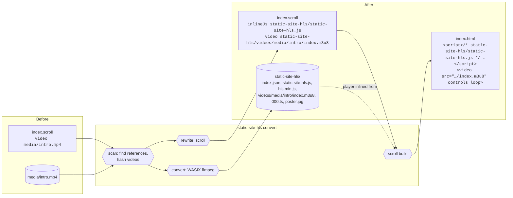

# How static-site-hls works with a Scroll site

[Scroll](https://scroll.pub) builds a site's HTML from `.scroll` files. static-site-hls changes the `.scroll` files and leaves the HTML to `scroll build`, so a site stays buildable by Scroll alone and nothing the tool does is lost on the next build.

## What it touches

| In the site | Read | Written |
| --- | --- | --- |
| Every `.scroll` file, except in the data folder, dot-folders and `node_modules` | yes | only the spans that point at videos, plus one player line per page that plays HLS |
| Video files those files point at | yes (hashed, converted) | never |
| `<data-dir>/` (default `static-site-hls/`) | yes | entirely managed by the tool |
| Built HTML | no | only through `scroll build` |
| Anything else | no | no |

## The round trip

<details>
<summary><h4>◆&ensp;Diagram&ensp;·&ensp;A Scroll site before and after convert&ensp;<sub>click to expand</sub></h4></summary>



</details>

The same example as text diffs (from a real run):

```diff
 # Welcome

-video media/intro.mp4
+inlineJs static-site-hls/static-site-hls.js
+video static-site-hls/videos/media/intro/index.m3u8
  loop
```

and in the built `index.html`:

```html
<video src="static-site-hls/videos/media/intro/index.m3u8" controls loop></video>
```

## Finding references

Scroll files are trees of *particles*: a line, and the lines below it indented by more spaces. `analyzeScroll()` (src/scroll.js) walks that tree and recognizes:

| Scroll construct | What is matched | Rewritten to |
| --- | --- | --- |
| `video clip.mp4` (scroll's `videoParser`) | the URL atom | `video <playlist>` |
| `clip.mp4` alone on a line (`quickVideoParser`: `.mp4`, `.webm`, `.avi`, `.mov`) | the whole line | `video <playlist>`, because a quick line can't end in `.m3u8` |
| `script` block | every string literal (`"…"`, `'…'`, `` `…` `` without `${`) | the literal's content |
| `html` block or a line starting with `<` | `src` of `<video>` and `<source>` tags; `type` of `<source>` | `src="<playlist>"`, `type="application/vnd.apple.mpegurl"` |
| `inlineJs …/static-site-hls.js` | the player line | kept, moved or removed |

A match only counts when it resolves to an existing local file with a video extension (`.mp4 .m4v .mov .webm .mkv .ogv .avi`), or to a playlist the index already maps back to a source (pages that were rewritten before). External URLs, `data:`/`blob:` URLs and paths outside the site are ignored.

Blocks whose children are raw text are skipped entirely: `code` and its variants, `css`, comments (`comment`, `//`, `!`, `thanksTo`), `quote`, `plainText`, `katex`, `chat`, the `assert…` family, `inlineCss`, `inlineJs`, and parser definitions (`…Parser`). The list mirrors the parsers of Scroll 180.2.0 whose children are not Scroll (`RAW_CUES` in src/scroll.js); a new Scroll raw-text parser needs adding there.

### Path resolution

- A relative URL resolves against the `.scroll` file's folder, as if the page were built next to it; a root-absolute URL (`/media/x.mp4`) against the site root.
- Rewrites keep the style: relative stays relative, root-absolute stays root-absolute. URLs are percent-encoded (quotes included), so they are safe in string literals, attributes and as Scroll atoms.
- Limitation: a page with a `permalink` into another folder, or a file imported from another folder, is resolved relative to its own `.scroll` file and can come out wrong.
- Limitation: a string literal that equals a video path is rewritten even if the script uses it for something else, such as a download link.

## The player line

Each page that plays at least one converted video gets exactly one line, inserted before the first top-level particle that uses one:

```
inlineJs static-site-hls/static-site-hls.js
```

Scroll's `inlineJs` copies the file into the page as `<script>/* path */ …contents…</script>`. Later runs find the line by its file name and move it (new `--data-dir`), drop duplicates, or remove it when the page no longer plays HLS. Because each built page holds a copy, `convert` rebuilds the site whenever the player file's contents change (new `--videos-dir`, `--posters`/`--no-posters`, or a new static-site-hls version).

## Running `scroll build`

`scroll-build.js` runs after the sources are saved, when any source changed or the player changed:

- once per folder that contains `.scroll` files, passing that folder's files explicitly. Every folder is rebuilt, not only the changed ones, because Scroll files can import each other;
- with `node_modules/.bin/scroll` in the site if present (pin a Scroll version per site that way), else `scroll` from `PATH`;
- through a symlink in the temp folder when the folder's path contains whitespace: Scroll splits paths on spaces and would otherwise write the HTML elsewhere;
- never with `--no-build`, for sites built by CI or by hand.

Scroll stamps its own version into every page (`<meta name="generator" content="Scroll v…">`), so a different Scroll version on the developer's machine shows up as a diff in every built page. That is Scroll, not this tool.
