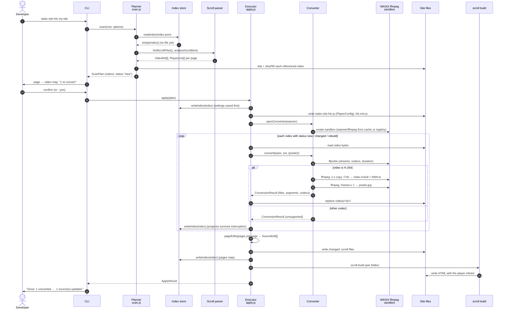
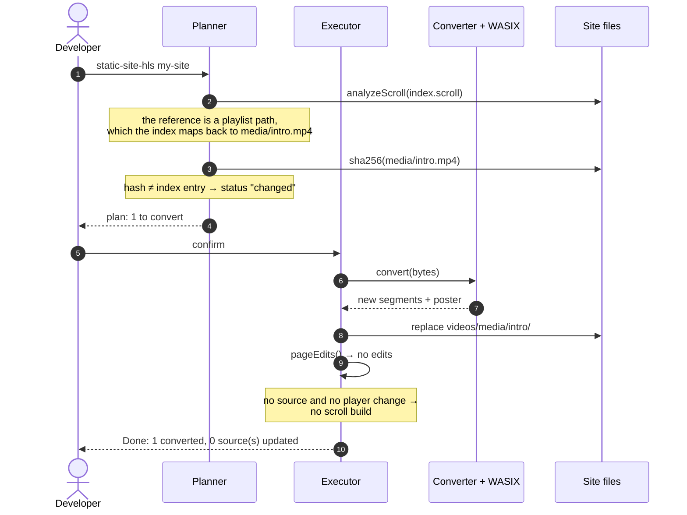
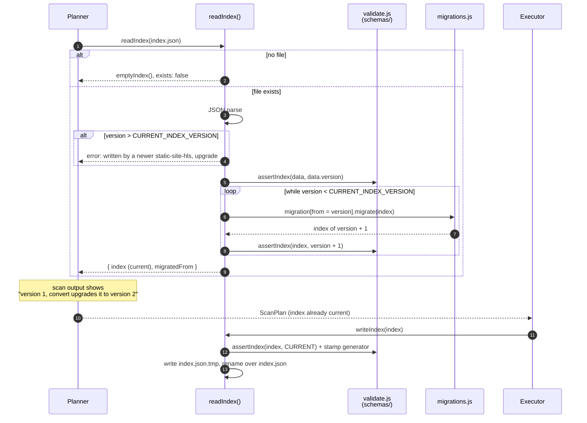
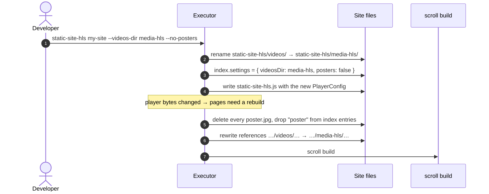
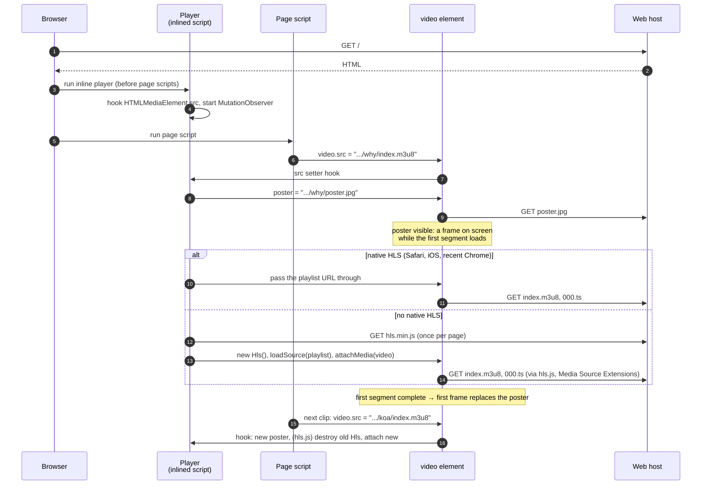
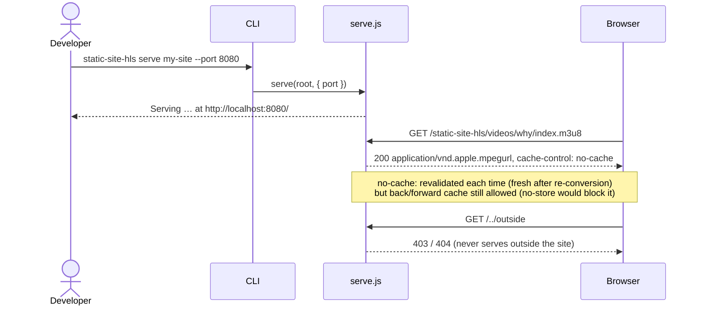

# Workflows

Timing diagrams for what happens, in which order, when static-site-hls runs and when a visitor plays a video. Names on the arrows are the functions and the [types](data-model.md) passed.

- [convert, first run](#convert-first-run)
- [convert after a video changes](#convert-after-a-video-changes)
- [Reading and migrating the index](#reading-and-migrating-the-index)
- [Changing settings](#changing-settings-videos-dir-posters)
- [Page load and playback](#page-load-and-playback)
- [serve](#serve)

Developer-side workflows (tests, dependency updates, releases) are in [development.md](development.md).

## convert, first run

A site with one page and one video, no data folder yet: `static-site-hls my-site`.

Diagram: convert, first run

The WASIX sandbox is created only when a video needs converting; a run that only rewrites sources or moves folders never loads ffmpeg.

## convert after a video changes

The developer overwrote `media/intro.mp4` in place. Pages already point at the playlist, so only the HLS output and the index change.

Diagram: convert after a video changes

Other reasons a video is converted again: its HLS output folder or (with posters on) its `poster.jpg` is missing (`rebuild`). Unchanged videos are never touched: the content hash, not the file date, decides.

## Reading and migrating the index

Every `scan` reads the index through the index store. Older versions are upgraded in memory; the file on disk changes only when `convert` saves it.

Diagram: reading and migrating the index

## Changing settings: `--videos-dir`, `--posters`

Diagram: changing --videos-dir and --posters

Both settings are saved in the index, so later runs keep them without the flags.

## Page load and playback

A visitor opens a page whose script does `video.src = "static-site-hls/videos/why/index.m3u8"` (launchation.com's background video works this way).

Diagram: page load and playback

Markup works the same way through the MutationObserver: `<video src="….m3u8">` or a `<source>` with a playlist triggers the poster and, without native HLS, hls.js.

Why posters matter: a video can't show anything until its whole first segment has arrived, and segments split on the source's keyframes (often 8 s apart, hundreds of KB). On a throttled mobile connection that measured 10.6 s of empty background on launchation.com without posters, and about 4 s Speed Index with them.

## serve

Diagram: serve

